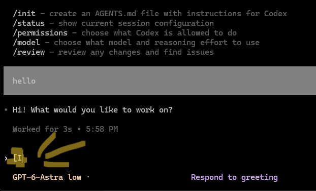

# EscGuard

**TL;DR:** Using Codex over SSH from Windows kept putting random extra characters in my terminal when I pressed arrow keys, scrolled, or switched windows. This runs Codex through tmux and stops it happening for me. It is a workaround, not a perfect fix.

I use agentic coding tools over SSH from Windows to Linux. In Codex, ordinary things like pressing an arrow key, scrolling, or switching windows sometimes put extra characters such as `[A`, `[B`, and `[O` into the prompt. It is frustrating when I just want to use the terminal freely.



I investigated it and found that parts of a key sequence sometimes arrived separately, about 20 milliseconds apart. **EscGuard is my workaround:** it runs Codex inside a quiet tmux session that waits a little longer for the whole sequence. It is not a perfect fix, but it suits my setup.

My setup when I found the issue: **Windows PowerShell → SSH → Debian 13, Codex CLI 0.167.0**. Claude Code is another agentic terminal tool I use, but I could not check its installed version here, and this launcher currently starts **Codex only**. I am not claiming that it fixes Claude Code yet.

## Install on the Linux machine

You need Codex, Bash, tmux, and the `tmux-256color` terminal entry. On Debian:

```bash
sudo apt install tmux ncurses-bin ncurses-term
git clone https://github.com/peripheralmike/escguard.git
cd escguard
./install.sh
```

The installer puts `codex-ssh` in `~/.local/bin`. If that directory is not on your `PATH`, add this line to `~/.bashrc` and start a new shell:

```bash
export PATH="$HOME/.local/bin:$PATH"
```

## Use it

```bash
codex-ssh
```

To resume a conversation:

```bash
codex-ssh resume --last
```

If you want to keep typing `codex`, put this in `~/.bash_aliases`:

```bash
alias codex='codex-ssh'
```

Then run `source ~/.bash_aliases` in the current shell. Debian's default interactive Bash configuration loads that file in new shells.

## What to expect

EscGuard gives terminal sequences **200 ms** to finish. This stopped the stray characters in my controlled input test, including split arrow, focus, click, and scroll events. A real Escape key can consequently feel about 200 ms slower.

It uses its own tmux server, with no status bar or tmux command prefix. If you already run inside tmux, EscGuard starts Codex directly, so your existing tmux settings determine the result. If the workaround does not help your setup, adjust `escape-time` in `~/.config/escguard/tmux.conf` or stop using the launcher.

After an SSH disconnect, you can find and reattach a surviving session:

```bash
tmux -L escguard list-sessions
tmux -L escguard attach-session -t SESSION_NAME
```

The installer backs up files it replaces. To remove EscGuard, exit its sessions, remove the alias if you added it, and delete `~/.local/bin/codex-ssh` and `~/.config/escguard`.

For project checks, run `python3 -m unittest discover -s tests -v`.
